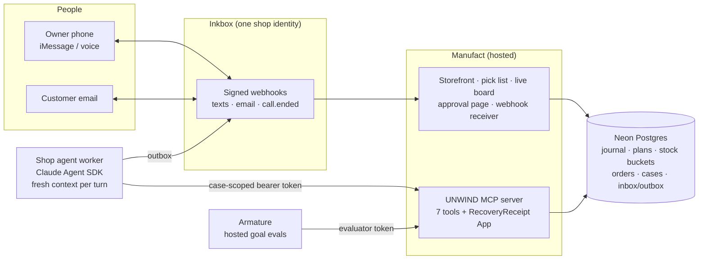

# UNWIND ↩️

**Rollback for ecommerce agents that keeps customer promises.** Undo the experiment, not the orders.

> **Team:** Shanay Gaitonde


UNWIND is an MCP server that gives a shop agent commerce-aware undo:
- Every store change the agent makes is recorded with exact before/after values and revisions.
- Later, a *fresh* agent with no memory of the launch can withdraw just the part the owner no longer wants.
- Edits other people made since, unrelated changes, and every accepted order are preserved.

The owner approves by text, customers get answers by email, and the server proves the result by reading the store back.

It runs on a controlled, Shopify-style test store (Postgres), not a Shopify integration. Checkout is test-only, and no payments are taken.

---

## Why this matters

Agents are starting to run stores: launching promotions, repricing, rewriting product pages. Undoing a change is easy when nothing happened in between. It's hard once customers have acted on the change.

The scenario below ran on the deployed build. Every number comes from the database, and the run is recorded in `reports/runs/unwind-1.json`.

1. **The experiment.** Trailhead Outfitters' agent launches *"one free travel pouch with any premium order, 10 set aside."* UNWIND records the offer, the homepage banner and the product copy, and moves 10 pouches from *available* to *held by the offer*.
2. **Customers accept it.** Four test orders accept the offer at checkout. Each order records its gift (zero price, accepted terms, campaign version, allocation). The four pouches now belong to those orders: **6 held, 4 committed**.
3. **The owner changes their mind** by text: *"Stop the free-pouch experiment. Restore the campaign pages, honor every accepted order, and release only unused promotional stock."* A fresh agent finds the rollout and previews the recovery: **4 stay committed, 6 releasable**. It texts the plan with a one-time approval code.
4. **A fifth order lands before the plan is applied.** The owner replies `YES`, but the plan is now stale. UNWIND rechecks the order dependencies under lock, refuses the plan (**nothing is written**), and the agent sends a refreshed plan: **5 stay committed, 5 releasable**, with a new code. The old approval can't be stretched to cover it.
5. **Applied and verified.** The offer is closed to new orders, exactly the 5 unused pouches return to stock, all 5 orders keep their gift, and the banner and copy are restored. Verify reads back stock books, order snapshots and the pick list: **0 held · 5 committed · 5 available · 10 on hand**.
6. **A customer asks** by email whether their pouch is still included. The agent answers from that customer's own verified orders: included, set aside, not shipped yet.

**The agent changed course without handing the cleanup back to a person, and no customer promise was broken.**

---

## How it works



| # | Component | Role | Technology |
|---|---|---|---|
| 1 | **MCP server** | Seven typed tools: history, preview, impact, apply, verify, typed rollouts, capabilities | mcp-use 2.10 on Manufact, bearer auth |
| 2 | **Recovery engine** | Revision-checked writes, conflict classification, atomic groups, readback verification | TypeScript, Postgres triggers and row locks |
| 3 | **Purchase-aware adapter** | Gift promotions, allocations, order entitlements, stock buckets, dependency watermark | `src/promotions/gift.ts`, migration 004 |
| 4 | **RecoveryReceipt App** | MCP App views for `undo_preview` / `undo_verify`: per-change values, conflicts, gift-stock strip | React via `mcp-use/react` |
| 5 | **Channels** | Owner iMessage + contact-scoped voice, customer email, signed receiver, durable inbox/outbox | Inkbox TS SDK |
| 6 | **Shop agent worker** | One fresh agent turn per event, case-scoped credentials, YES-code approvals checked in code | Claude Agent SDK (Claude Opus 5.5) |
| 7 | **Evaluation** | Hosted goal cases + deterministic database checks, plus fresh-agent goal evals | Armature CI API, `harness/eval-agent.ts` |

---

## How we used each sponsor tool

**Manufact: hosting the MCP and its App**
- The UNWIND MCP server is deployed on Manufact Cloud from this repo. Every push to `main` builds and rolls out automatically.
- The live endpoint is `https://bold-cloud-77gfl.run.mcp-use.com/mcp`, and every request needs a bearer token.
- `undo_preview` and `undo_verify` render the **RecoveryReceipt** MCP App: original/launch/current values, conflicts, kept exceptions, order impact, approval state and gift stock.
- The same deployment serves the storefront, pick list, live board, owner approval page and the Inkbox webhook receiver.
- Evidence:
  - deployed MCP probe 10/10 (`reports/mcp-probe.json`)
  - App views rendered from the hosted server (`reports/app-view/`)
  - three MCP clients: the Claude Agent SDK worker, Claude Code CLI (`reports/clients/claude-code.json`) and the mcp-use App host

**Inkbox: one identity for the owner and the customers**
- One Inkbox agent identity carries the owner's text thread, the owner's voice calls, and the shop mailbox for customers.
- Inbound events arrive as signed webhooks: an HMAC over request id, timestamp and raw body, plus a bearer token. They are persisted under a unique provider event id before any work runs.
- Outbound messages go through a deduplicated outbox with budgets, and the provider's real delivery states (`accepted` → `delivered`) are tracked.
- Owner and customer conversations run as separate cases with separate credentials and model contexts.
- Voice uses Inkbox's hosted call agent with `contact_scoped` authority on every call, a 180 s hang-up limit and one call per plan. The call transcript is treated as the owner's *intent*, never as approval.
- Evidence: live runs in `reports/runs/`, covering owner text in and out, the owner voice call (`live-2-owner-voice.json`) and customer email in and out.

**Armature: does an unfamiliar agent use UNWIND correctly?**
- We registered the deployed MCP in Armature with an evaluation-store token (it can't see the demo store).
- Five goal cases were created through Armature's API (`scripts/armature.ts`). Before every run the evaluation store is reset to a fixed fixture.
- Each Armature verdict is stored next to our own deterministic database check (`reports/armature.json`):

| Case | Goal | Judge (Claude Haiku 4.5 tester) | DB check |
|---|---|---|---|
| E | Stop the gift experiment, honor accepted orders | **passed** 5/5 | pass (4 kept, 6 released) |
| B | Which orders really used a launch price? (read-only) | **passed** 5/5 | pass |
| D | "Undo everything" reports an honest partial result | **passed** 5/5 | pass |
| C | Refuse a cap-breaking 40% sale | partial 3/5 | pass |
| A | Selective premium withdrawal | failed | fail: the tester marked the conflict as an owner exception, which needs the owner's own approval |

A run with Armature's default `gpt-4o-mini` tester on case C also failed. That tester used a permitted recovery instead of answering the request, and misreported the result. We kept it: it's exactly the kind of agent behavior UNWIND's verify step and the judge are there to catch.

**Also used:** **Neon** Postgres as the store of record (the main branch holds the demo and evaluation stores, a separate branch the tests), and the **Claude Agent SDK** for the shop agent and the fresh-agent evaluations.

---

## Why it helps agents

UNWIND is built for agents to call, not for people to click through:
- **Selection without copying IDs.** `undo_preview {rollout_id, labels:["premium"]}` or `{all_changes:true}`. The rollout is inferred when only one could match, and when several could, the error lists the candidates.
- **No guessing old values.** The agent never supplies before-values or inverses. Everything comes from the recorded journal.
- **Safe retries.** Idempotency keys are optional and default to keys derived from the plan or approval, so a retried call never applies twice and returns the stored outcome.
- **Honest outcomes.** Results are `fully_reverted`, `resolved_with_exceptions`, `partially_reverted` or `blocked`. Conflicts are withheld, never overwritten.
- **Stale plans are explicit.** `stale_dependency_state` comes with a fresh plan and its new counts, and the old approval can't be reused.
- **Self-describing.** `undo_capabilities` returns quickstart recipes. Every response and error carries a stable code and a `next_action`, and tool summaries state the key numbers in plain words ("5 accepted orders keep 5 gifts; 5 units go back to stock").
- **Proof, not trust.** `undo_verify` derives its verdict from readback: no unselected writes, order snapshots byte-identical, stock buckets reconciled with their owners, pick list complete.

---

## MCP tools

| Tool | What it does |
|---|---|
| `undo_capabilities` | Role, store, supported components, limits, recovery rules, stock per product, quickstart recipes |
| `undo_history` | Rollouts with change ids, labels, before/after values, revisions, recovery status, label counts |
| `undo_execute` | Propose a typed rollout (`set_price`, `set_content`, `set_slot`, `start_gift_promotion`), then run it after the owner approves its exact hash |
| `undo_preview` | Build a recovery plan by labels, `all_changes` or change ids; classify each change as eligible / conflict / kept / already reverted; purchase dependencies for gift offers. Nothing is written |
| `undo_impact` | Orders linked by captured price provenance vs. coincidental vs. unknown; gift commitments by entitlement; customers see only their own orders |
| `undo_apply` | Apply under lock with owner approval (or a narrow standing grant). Retires gift offers purchase-aware; refuses stale plans |
| `undo_verify` | Readback verdict: restored components, preserved edits, byte-identical orders, stock accounting, pick list, communications |

Example: preview stopping a whole experiment, then apply with the owner's approval.

```bash
curl -s https://bold-cloud-77gfl.run.mcp-use.com/mcp \
  -H "Authorization: Bearer $UNDO_AGENT_TOKEN" -H "content-type: application/json" \
  -H "accept: application/json, text/event-stream" \
  -d '{"jsonrpc":"2.0","id":1,"method":"tools/call","params":{"name":"undo_preview","arguments":{"rollout_id":"ro_…","all_changes":true}}}'
```

```json
{
  "plan_id": "plan_…", "plan_hash": "…", "will_restore": 3,
  "purchase_dependencies": [{
    "title": "Free travel pouch", "initially_allocated": 10,
    "committed_to_accepted_orders": 4, "held_unallocated": 6, "releasable_on_apply": 6,
    "outcomes_on_apply": ["retire_future_use", "release_remaining: 6 held unit(s) return to available stock", "preserve_order_commitment: 4 gift(s) stay committed to 4 accepted order(s)"]
  }],
  "approval": "owner_confirmation_required",
  "next_action": "get the owner's confirmation of this plan_hash, then call undo_apply"
}
```

Connecting your own client (Claude Code, any JSON-config MCP client, the Agent SDK) is covered in [docs/CLIENTS.md](docs/CLIENTS.md).

---

## Results and reliability

| Check | Result |
|---|---|
| Unit / integration / security tests | 9 / 63 / 15 passing (`pnpm test`, `pnpm test:security`) |
| Acceptance contract (U01–U32 core, V01–V05 voice) | **37 / 37** with evidence ([reports/FINAL_VERIFICATION.md](reports/FINAL_VERIFICATION.md)) |
| Purchase-aware contract (PA01–PA12) | **12 / 12** ([reports/PURCHASE_AWARE_ACCEPTANCE.md](reports/PURCHASE_AWARE_ACCEPTANCE.md)) |
| Race orderings | Barrier-coordinated tests for checkout-first and retirement-first; a losing checkout gets `OFFER_CHANGED_RECONFIRM`, never a silently dropped gift |
| Retries and crashes | An injected failure after the retirement writes rolls everything back; replayed applies return the stored outcome; no second stock release |
| End-to-end rehearsals (real owner text, real email, real agent) | 3 × UNWIND race sequence + 3 × premium withdrawal: identical outcomes, verify `verified` (`reports/runs/`) |
| Fresh-agent goal evals on the deployed MCP | Cases A–F pass (`reports/eval-agent.json`) |
| Deployed probes | MCP 10/10, smoke 11/11, browser e2e 11/11, provider smoke 7/7 |

Security model and honest limits: [docs/SECURITY_AND_LIMITS.md](docs/SECURITY_AND_LIMITS.md).

---

## Run it

```bash
pnpm install
```
```bash
pnpm db:migrate && pnpm demo:reset
```
```bash
pnpm dev
```
```bash
env -u CLAUDE_CODE_OAUTH_TOKEN pnpm worker
```

Config names are in [.env.example](.env.example). Demo scripts:
- `pnpm demo:launch -- --scenario pouch`: a real agent launches the gift experiment
- `pnpm demo:activity -- --scenario pouch`: four test orders through checkout
- `pnpm demo:activity -- --scenario pouch-one`: the fifth order

The full on-camera walkthrough is in [docs/RECORDING_READY.md](docs/RECORDING_READY.md). Deploy with `pnpm run deploy`, which pushes `main` and waits for that commit's Manufact deployment.

---

## Tech stack

| Layer | Choice |
|---|---|
| MCP server and App views | mcp-use 2.10 (Hono routes, React views), hosted on Manufact Cloud |
| Data | Neon Postgres 18, `pg`, trigger-guarded writers, append-only journals |
| Agent | Claude Agent SDK, Claude Opus 5.5, MCP over streamable HTTP |
| Channels | Inkbox SDK (iMessage, email, hosted voice, signed webhooks) |
| Evaluation | Armature (hosted goal cases), Vitest, Playwright |
| Language | TypeScript (Node 22+), zod |

## Project structure

| Path | Contents |
|---|---|
| `index.ts` | MCP server: seven tools, auth gate, storefront/board/approval routes, Inkbox receiver |
| `src/recovery/` | execute, preview/apply (`plan.ts`), verify, history, receipt model |
| `src/promotions/gift.ts` | purchase-aware adapter: allocations, entitlements, stock moves, retirement |
| `src/orders/`, `src/impact/` | test checkout with provenance, order snapshots, impact classification |
| `src/approvals/`, `src/comms/`, `src/cases/` | owner approvals (YES codes, link page), Inkbox outbox/receiver/voice, cases |
| `src/db/migrations/` | schema, triggers, guards (001–004) |
| `src/web/`, `src/ui/`, `views/` | storefront, pick list, live board, approval page, RecoveryReceipt App |
| `worker/` | shop agent worker (Claude Agent SDK) and runner |
| `harness/`, `scripts/` | launch agent, fresh-agent evals, Armature driver, rehearsals, probes, deploy, reports |
| `tests/` | unit, integration (incl. races and the UNWIND sequence), security |
| `reports/` | machine-readable evidence: test results, live runs, evals, Armature, deploys |
| `docs/` | client setup, security and limits, demo runbooks, original spec, build log |

## Deployment

Manufact builds and deploys every push to `main`. The deployment runs the MCP server and web routes. The shop agent worker runs separately against the hosted MCP, using a local Claude login and the same database. Secrets live only in the deployment environment and ignored local config (`.env`, `.private/`).

## License

[MIT](LICENSE) © 2026 Shanay Gaitonde
